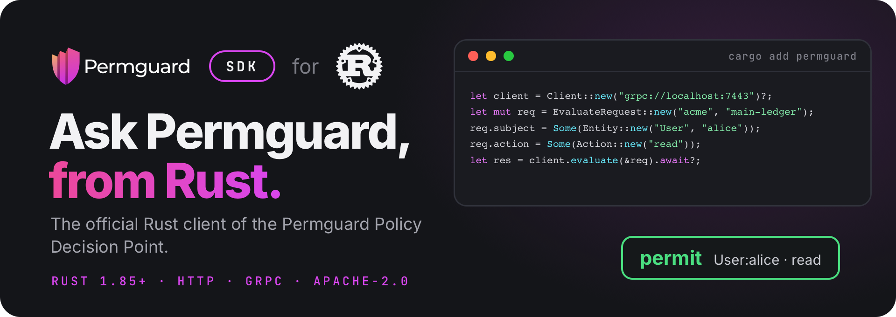

<!-- Copyright (c) 2022 Nitro Agility S.r.l. -->
<!-- SPDX-License-Identifier: Apache-2.0 -->

# Permguard Rust SDK

[](https://crates.io/crates/permguard)
[](https://docs.rs/permguard)
[](https://github.com/permguard/sdk-rust/actions/workflows/sdk-rust-ci.yml)
[](https://www.apache.org/licenses/LICENSE-2.0)

<p align="center">
  
</p>

<p align="center">
  <a href="https://github.com/permguard/permguard"><b>Permguard</b></a> ·
  <a href="https://docs.permguard.com/"><b>Documentation</b></a> ·
  <a href="#install"><b>Install</b></a> ·
  <a href="#quick-start"><b>Quick start</b></a> ·
  <a href="#develop"><b>Develop</b></a>
</p>

**The official Rust client of the Permguard Policy Decision Point.**

Before your code acts, it asks Permguard whether a subject may perform an action on a resource, and Permguard answers from the policies of a ledger.
This crate is how Rust code asks: one async client for the native, stateless PDP interface `permguard.api.pdp.native.v1`, over HTTP/JSON or gRPC, with the same request and the same answer on both.

<p align="center">
  
</p>

<p align="center"><sub>Your code asks, the SDK carries the question, the data plane decides with the ledger's policies.</sub></p>

## Install

The crate needs Rust 1.85 or newer.
Its client is async and runs on Tokio, so an application adds both:

```console
cargo add permguard
cargo add tokio --features macros,rt-multi-thread
```

It needs a Permguard data plane to ask: by default it listens on port `7443`, for HTTP and gRPC alike.
See the [Permguard repository](https://github.com/permguard/permguard) to run one.

## Quick start

```rust
use permguard::{Action, Client, Entity, Error, EvaluateRequest};

#[tokio::main]
async fn main() -> Result<(), Box<dyn std::error::Error>> {
    // grpc:// or grpcs:// speaks gRPC; http:// or https:// speaks JSON.
    let client = Client::new("grpc://localhost:7443")?;

    let mut request = EvaluateRequest::new("acme", "main-ledger");
    request.profile = Some("gateway".to_owned());
    request.subject = Some(Entity::new("User", "alice"));
    request.resource = Some(Entity::new("Document", "budget-2026"));
    request.action = Some(Action::new("read"));
    request.request_id = Some("example-1".to_owned());

    match client.evaluate(&request).await {
        Ok(response) => println!("{}", if response.decision { "PERMIT" } else { "DENY" }),
        Err(Error::Refusal(refusal)) => eprintln!(
            "refused: class={} code={} message={}",
            refusal.error_class, refusal.code, refusal.message
        ),
        Err(error) => return Err(error.into()),
    }
    Ok(())
}
```

The same program is in [examples/main.rs](examples/main.rs): `cargo run --example main -- grpc://localhost:7443`.

### The request

| Field                                | What it says                                                            |
| ------------------------------------ | ----------------------------------------------------------------------- |
| `EvaluateRequest::new(zone, ledger)` | the ledger whose policies decide, in its zone                           |
| `profile`                            | the profile of the ledger's manifest that selects the partitions to run |
| `subject`                            | who asks: a type and an id, with optional `properties`                  |
| `resource`                           | what is acted on: a type and an id, with optional `properties`          |
| `action`                             | what is done: a name, with optional `properties`                        |
| `context`                            | any other fact the policies read                                        |
| `partition_inputs`                   | runtime data for the partitions of the profile, see below               |
| `request_id`                         | your id for the call, given back in the answer                          |

### The answer

A deny is not an error: it is a successful response whose `decision` is `false`.
Validation, authorization, availability and server failures are `Error::Refusal`, with their stable `error_class` and `code`, and the HTTP or gRPC status they came with.
Every other `Error` variant says the endpoint, an option or the transport failed before Permguard answered.

## Partition inputs

Runtime data is addressed to the partition name the ledger's profile declares.
The data is a `serde_json::Value`, so the `json!` macro below needs `serde_json` in your own dependencies, as Tokio does: `cargo add serde_json`.

```rust
use permguard::PartitionInput;
use serde_json::json;

request.partition_inputs.insert(
    "authorization".to_owned(),
    PartitionInput::new(
        "permguard.cedar.entities.v1",
        json!([{
            "uid": { "type": "Team", "id": "engineering" },
            "attrs": { "active": true },
            "parents": [],
        }]),
    ),
);
```

The key is a partition name from the selected profile.
The input type asserts the partition's input contract; it does not select a policy runtime.

## Many evaluations at once

Set the defaults on the request, list the `evaluations`, and call `evaluate_many`:

```rust
use permguard::{Evaluation, EvaluationOptions, EvaluationsSemantic};

let mut request = EvaluateRequest::new("acme", "main-ledger");
request.subject = Some(Entity::new("User", "alice"));
for name in ["read", "update"] {
    request.evaluations.push(Evaluation {
        resource: Some(Entity::new("Document", "budget-2026")),
        action: Some(Action::new(name)),
        request_id: Some(name.to_owned()),
        ..Evaluation::default()
    });
}
request.options = Some(EvaluationOptions {
    evaluations_semantic: EvaluationsSemantic::ExecuteAll,
});

let response = client.evaluate_many(&request).await?;
for result in &response.evaluations {
    println!("{:?}: {}", result.request_id, result.decision);
}
```

An evaluation whose `partition_inputs` is `None` inherits the request's.
`Some` of an empty map replaces them with no inputs.

## Endpoints and options

| Endpoint   | Transport                                      |
| ---------- | ---------------------------------------------- |
| `http://`  | JSON over HTTP                                 |
| `https://` | JSON over HTTPS                                |
| `grpc://`  | `permguard.data.v1.PolicyDecisionPoint`        |
| `grpcs://` | `permguard.data.v1.PolicyDecisionPoint` on TLS |

```rust
use std::time::Duration;
use permguard::ClientOptions;

let client = Client::with_options(
    "https://pdp.example.com",
    ClientOptions::default()
        .with_timeout(Duration::from_secs(5))
        .with_header("authorization", format!("Bearer {token}")),
)?;

let configuration = client.get_configuration().await?;
```

| Option             | Sets                                        |
| ------------------ | ------------------------------------------- |
| `with_timeout`     | the timeout of every call                   |
| `with_header`      | a static header, also sent as gRPC metadata |
| `with_http_client` | a preconfigured `reqwest::Client` for HTTP  |

`get_configuration` reads the data plane's discovery document.
The client is cheap to clone and reuses its HTTP pool or gRPC channel: create it once and share it.

## Compatibility

This major version implements `permguard.api.pdp.native.v1`.
Compatibility is tied to that versioned interface, not to a server minor version.

## Develop

```console
cargo fmt --all -- --check
cargo clippy --all-targets --all-features --locked -- -D warnings
cargo test --all-targets --locked
cargo package --locked
```

The published crate includes `LICENSE`, `NOTICE.md`, `THIRD_PARTY_NOTICES.md` and `TRADEMARKS.md`.

## License

Apache License 2.0: see [LICENSE](LICENSE), [NOTICE.md](NOTICE.md) and [THIRD_PARTY_NOTICES.md](THIRD_PARTY_NOTICES.md).

Permguard is a trademark of Nitro Agility S.r.l., see [TRADEMARKS.md](TRADEMARKS.md).
Rust and the Rust logo are trademarks of the Rust Foundation, shown only to name the language this SDK is for.
